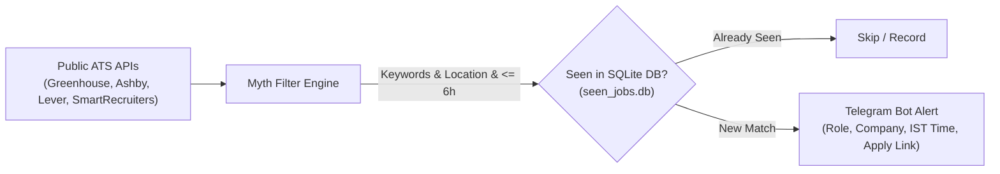

# Myth - Personal ATS Job Watcher & Scraper

**Myth** is an automated, real-time job-discovery assistant tailored exclusively for **Abhijeet Singh**. It directly probes public Applicant Tracking System (ATS) APIs (Greenhouse, Ashby, Lever, SmartRecruiters) to catch freshly published engineering and developer roles before they appear on commercial aggregators.

---

## 🎯 Profile Tailoring

Myth is curated specifically for:
* **Level:** 4th-Year Undergraduate / Fresher (0 Years Experience)
* **Domain:** Java Developer, Full-Stack, Backend, Frontend (Java, Spring Boot, React, Node, REST APIs)
* **Target Roles:** Software Development Engineer (SDE / SWE / SDE 1), Associate Software Engineer, Member of Technical Staff (MTS), Graduate Engineer Trainee (GET), Frontend Developer, Backend Developer, Full-Stack Developer, Engineering Intern.
* **Strict Exclusions:** All senior, staff, lead, principal, architect, manager, and multi-year experienced positions (`SDE II`, `SWE 2`, `Level 2+`, etc.), as well as non-tech roles (sales, HR, marketing, UI/UX design, customer support).
* **Strict Freshness Rule:** Only openings posted within the last **6 hours** (`MAX_AGE_HOURS = 6.0`) trigger alerts. Older active roles are filtered out so you are always among the first applicants.
* **Locations:** India (Bengaluru, Hyderabad, Pune, Delhi NCR, Noida, Gurgaon, Chennai, Mumbai, Kolkata, Ahmedabad) & Global Remote / Work-From-Home.

---

## 🚀 How It Works



1. **Direct Public ATS API Polling:** Instead of scraping heavy frontend DOMs or triggering CAPTCHA blocks, Myth queries official ATS JSON APIs.
2. **Instant Telegram Alerts:** When a job matches your profile and is $\le$ 6 hours old, an HTML-formatted alert is dispatched directly to your Telegram chat with the posting timestamp in IST and direct application link.
3. **Automated 24/7 Cloud Monitoring:** Runs via GitHub Actions cron twice every hour (`:12` and `:42` UTC offset), preserving history across runs with GitHub Cache.

---

## 💻 Usage & Commands

### 1. On-Demand Single Company Search
Search any company's job board live across Greenhouse, Ashby, Lever, and SmartRecruiters:
```powershell
# Check for fresh openings (< 6 hours old)
py search_company.py stripe

# Include all active openings (regardless of posting age)
py search_company.py stripe --all

# Push matched openings directly to your Telegram
py search_company.py swiggy --send-tg
```

### 2. Preview Current Watchlist Matches (Dry Run)
Inspect all matching roles currently live across all monitored companies without recording to the database:
```powershell
py job_watcher.py --dry-run
```

### 3. Local Background Watcher (Windows)
Run Myth silently in the background on your machine (checks every 30 minutes):
```powershell
.\start_background.ps1    # Starts silent background process
.\stop_background.ps1     # Stops background process
```

### 4. Bulk Company Scanner (300+ Tech Firms)
Scan a master list of companies ([`company_list.txt`](company_list.txt)) to discover active ATS endpoints and fresh openings:
```powershell
py bulk_scan_companies.py --fresh-only
```

---

## ⚙️ Configuration & Secrets

Myth uses a local `.env` file (never committed to Git) and GitHub Secrets for Telegram bot dispatch:
* `TELEGRAM_BOT_TOKEN`: Telegram bot token from `@BotFather`
* `TELEGRAM_CHAT_ID`: Your personal Telegram chat ID
